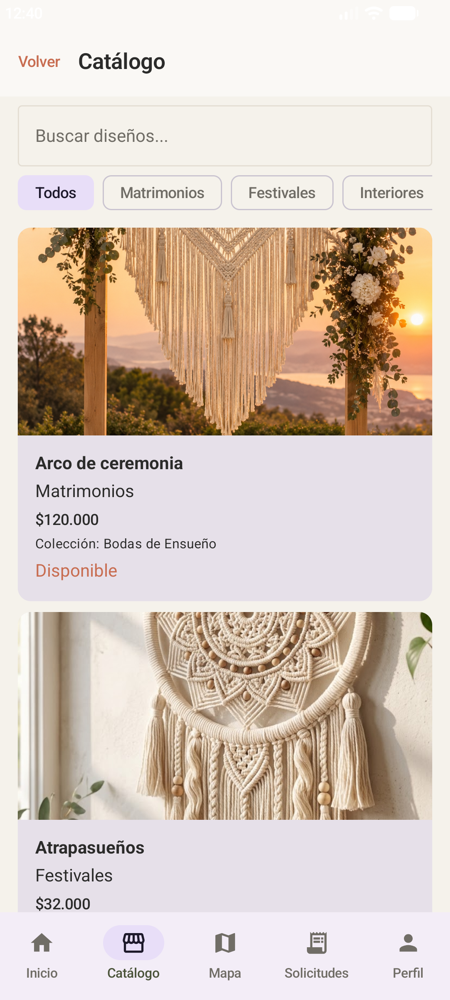
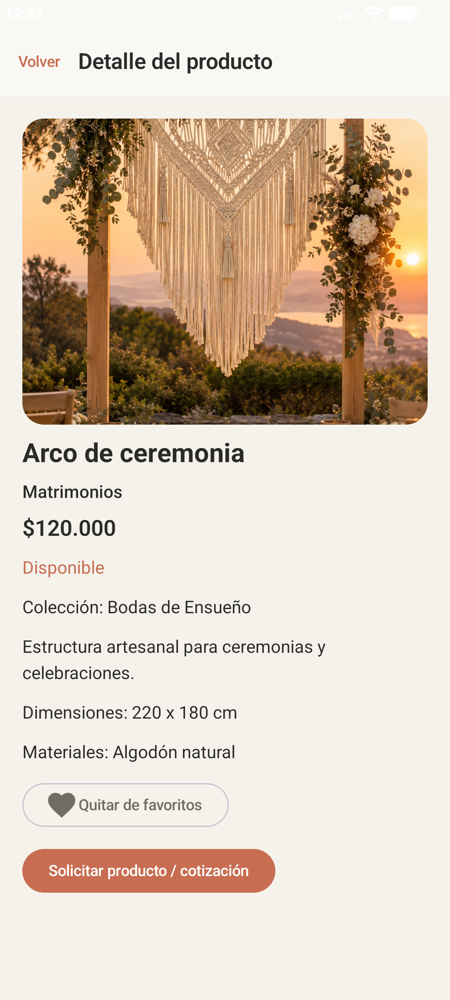
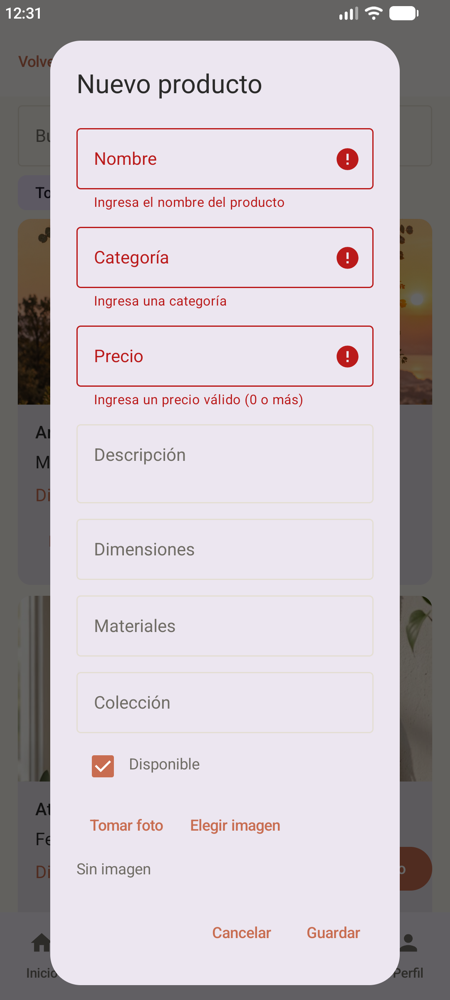
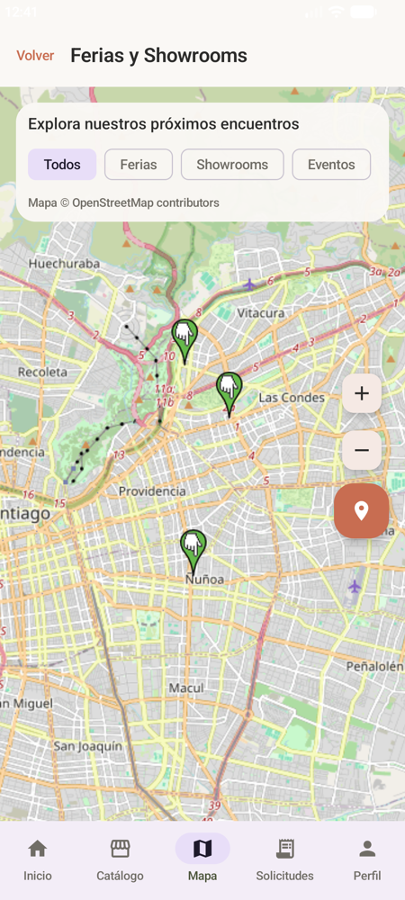

# Lou Araya Macramé — App móvil

Aplicación Android (Kotlin + Jetpack Compose + Material 3) para **Lou Araya Macramé**, un emprendimiento de piezas de macramé artesanal para matrimonios, festivales e interiores. Los clientes revisan el catálogo, guardan favoritos, encuentran ferias en el mapa, escanean el QR de un producto en una feria y piden cotizaciones a medida. La administradora gestiona el catálogo, las campañas y las solicitudes.

> Asignatura DSY1105 — Desarrollo de Aplicaciones Móviles · Duoc UC
> Backend (microservicios Spring Boot): repositorio **lou-araya-backend** → _agregar aquí el link de GitHub_

## Integrantes

| Integrante | GitHub |
|---|---|
| Andrés Jordan | andresjp23 |
| Diana Romero | Dianaromeroa |
| Ronald Troncoso | RonaldTroncoso-Duoc |

## Funcionalidades

**Cliente**
- Registro e inicio de sesión contra el microservicio de usuarios (contraseña con hash BCrypt en el servidor).
- Catálogo con búsqueda y filtros por categoría. Si no hay conexión, se muestra la última copia guardada en SQLite.
- Detalle de producto y favoritos (guardados en el dispositivo).
- Solicitud de cotización con formulario validado (menús desplegables y calendario). Se guarda en el microservicio de solicitudes.
- "Mis solicitudes": seguimiento del estado y cancelación de las que siguen pendientes.
- Mapa de ferias y showrooms (OpenStreetMap) con ubicación del usuario.
- Escáner QR de productos (cámara o imagen de la galería).
- Perfil: ver y editar nombre, alias y teléfono; preferencia de notificaciones.
- Bandeja de notificaciones y notificaciones locales.

**Administrador**
- CRUD de productos: crear, editar, activar/desactivar y eliminar, con foto desde la cámara o la galería y generación del QR de cada producto.
- CRUD de campañas y colecciones con validación de fechas.
- Gestión de solicitudes: ver las de todos los clientes y cambiarlas de estado. Solo se ofrecen las transiciones válidas.

**Recursos nativos:** cámara (CameraX + ML Kit para QR y fotos), GPS/ubicación (mapa), notificaciones locales y galería.

**Animaciones:** splash animado, transiciones entre pantallas (fundido + deslizamiento), cambios animados entre los estados "cargando / error / contenido", ítems de listas animados y el corazón de favoritos con efecto rebote.

## Arquitectura

MVVM con separación por capas:

```
app/src/main/java/com/example/evaluacion2/
├── domain/            # Modelos, reglas y contratos (no depende de Android)
│   ├── model/         # User, Product, QuoteRequest, UserRole (sealed), RequestStatus (enum con transiciones)
│   ├── repository/    # Interfaces: UserRepository, ProductRepository, CampaignRepository, RequestRepository
│   ├── validation/    # Validadores de formularios
│   └── error/         # AppException (sealed): Network, Unauthorized, NotFound, Conflict, Validation…
├── data/
│   ├── remote/        # Retrofit: APIs de cada microservicio, DTOs, mappers y traducción de errores HTTP
│   ├── repository/    # Implementaciones Remote*Repository (microservicios + caché local)
│   └── local/         # SQLite (AppDatabaseHelper) y SharedPreferences (SessionManager)
├── di/AppContainer.kt # Inyección de dependencias manual
├── viewmodel/         # BaseViewModel (abstracta) + un ViewModel por pantalla, UiState (sealed)
└── ui/                # Pantallas Compose, componentes y navegación
```

**Programación orientada a objetos**
- *Herencia:* todos los ViewModels heredan de `BaseViewModel`, que centraliza el manejo de errores (`launchSafe`, `load`). En el backend, las entidades heredan de `EntidadBase`.
- *Polimorfismo:* los ViewModels dependen de interfaces (`ProductRepository`…). La app usa las implementaciones remotas y los tests usan mocks. `UserRole` es una `sealed class` donde cada rol define sus privilegios (`canManageCatalog`, `canManageRequests`…), y `homeRouteFor(role)` decide la pantalla de inicio según el rol.
- *Excepciones:* `AppException` es una jerarquía sellada. `safeApiCall` traduce los errores HTTP y de red a esa jerarquía, y cada pantalla muestra el mensaje con la opción de reintentar.

**Almacenamiento: qué se guarda dónde**

| Dato | Dónde | Por qué |
|---|---|---|
| Usuarios, productos, campañas, solicitudes | Microservicios (H2) | Datos compartidos entre todos los usuarios y dispositivos |
| Sesión activa | SharedPreferences | Mantener la sesión abierta en este teléfono |
| Copia de productos y del perfil | SQLite | Ver el catálogo sin conexión; favoritos y QR funcionan offline |
| Favoritos, preferencias, notificaciones, historial de QR, ferias del mapa | SQLite | Datos personales de este dispositivo |

## Endpoints utilizados

**Microservicios propios** (ver el repositorio del backend)

| Servicio | Método y ruta | Uso en la app |
|---|---|---|
| ms-usuarios :8081 | `POST /api/usuarios/registro` | Registro |
| | `POST /api/usuarios/login` | Inicio de sesión |
| | `GET /api/usuarios/{id}` | Ver perfil |
| | `PUT /api/usuarios/{id}` | Editar perfil |
| ms-catalogo :8082 | `GET /api/productos` · `GET /api/productos/{id}` | Catálogo y detalle |
| | `POST /api/productos` · `PUT /api/productos/{id}` | Crear / editar producto |
| | `PATCH /api/productos/{id}/disponibilidad` | Activar / desactivar |
| | `DELETE /api/productos/{id}` | Eliminar producto |
| | `GET /api/campanas?activas=` · `POST` · `PUT /{id}` · `PATCH /{id}/estado` · `DELETE /{id}` | CRUD de campañas |
| ms-solicitudes :8083 | `GET /api/solicitudes?userId=` | Mis solicitudes / todas (admin) |
| | `POST /api/solicitudes` | Enviar cotización |
| | `PATCH /api/solicitudes/{id}/estado` | Cambiar estado (admin) |
| | `DELETE /api/solicitudes/{id}` | Cancelar solicitud pendiente |

**API externa**
- OpenStreetMap Tile Server (`https://tile.openstreetmap.org/{z}/{x}/{y}.png`), consumido con osmdroid en la pantalla del mapa de ferias.

## Cómo ejecutar

1. **Levantar el backend** (ver el README de `lou-araya-backend`): `mvn package` y luego los 3 `java -jar`. Deben responder `http://localhost:8081`, `:8082` y `:8083`.
2. **Abrir la app** en Android Studio (JDK 17 o superior, SDK 37) y ejecutar en un emulador.
   - El emulador accede al PC mediante `10.0.2.2`, que es la dirección por defecto.
   - **Android 17:** al abrir la app aparece el permiso de "dispositivos cercanos / red local". Hay que **aceptarlo**, porque es necesario para conectarse a los microservicios del PC.
3. **Celular físico** (opcional): en `local.properties` agregar `api.host=<IP del PC>` y esa IP en `app/src/main/res/xml/network_security_config.xml`. Otra opción por USB: `adb reverse tcp:8081 tcp:8081` (y lo mismo para 8082 y 8083) con `api.host=localhost`.

**Cuentas de prueba** (las crea el backend al iniciar)

| Rol | Correo | Contraseña |
|---|---|---|
| Administrador | admin@louaraya.cl | Admin123 |
| Cliente | cliente@louaraya.cl | Cliente123 |

## Pruebas unitarias

```bash
./gradlew :app:testDebugUnitTest          # 30 pruebas (JUnit 4 + MockK + kotlinx-coroutines-test)
./gradlew :app:koverHtmlReportDebug       # reporte en app/build/reports/kover/htmlDebug/index.html
./gradlew :app:koverVerifyDebug           # falla si la cobertura baja del 80 %
```

Cobertura de la lógica (ViewModels, repositorios, capa remota y dominio): **98,1 % de líneas** y 85,5 % de ramas. Las pantallas Compose y las clases que dependen del framework de Android (SQLite, notificaciones) quedan fuera de la medición.

## APK firmado

| Archivo | Ubicación |
|---|---|
| APK firmado | `apk/lou-araya-macrame-v2.0-release.apk` |
| Keystore | `keystore/lou-araya-release.jks` (alias `louaraya`) |
| Configuración de firma | `keystore.properties` + bloque `signingConfigs` en `app/build.gradle.kts` |

Para generarlo: `./gradlew :app:assembleRelease`. Verificación:

```
$ apksigner verify --print-certs apk/lou-araya-macrame-v2.0-release.apk
Verified using v2 scheme (APK Signature Scheme v2): true
Signer #1 certificate DN: CN=Lou Araya Macrame, OU=DSY1105, O=Lou Araya, L=Santiago, ST=RM, C=CL
Signer #1 certificate SHA-256 digest: 2e8a006cdb3a48c6b3995e053a8bf2d264497b4c39d177116aa110a0e00a54f7
```

> El `.jks` y sus contraseñas se incluyen en el repositorio solo porque la evaluación lo exige. En un proyecto real nunca se suben.

## Capturas

| Catálogo | Detalle | Validación de formulario | Mapa (API externa) |
|---|---|---|---|
|  |  |  |  |

## Trabajo colaborativo

- Planificación en Trello: _agregar link al tablero_.
- Commits por integrante: ver `git shortlog -sn` o la pestaña *Contributors* del repositorio.
